<!-- Designed for Muhammad Kaif · artwork lives in /assets -->

  

  
  
  
  

 

  

 

  
  
  
  
  
  

<a href="https://github.com/Kaifi1199?tab=repositories"><b>EXPLORE ALL REPOSITORIES ↗</b></a>

 

    
    
    
  
  
  
  
  

 

  

 

  

